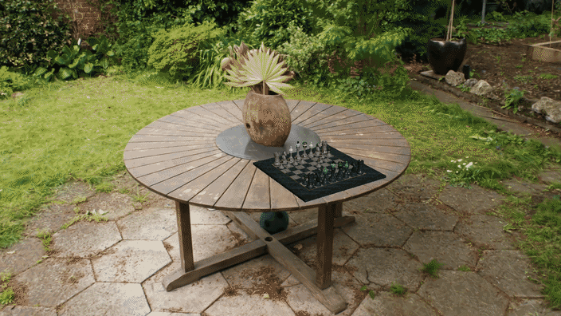
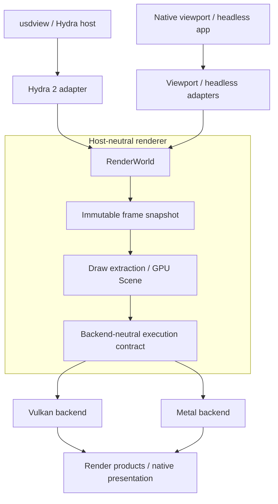

# Hydra Merlin

**A host-neutral real-time raster renderer for OpenUSD and beyond.**



*hdMerlin renders MaterialX-shaded meshes and 3D Gaussian splats together in one scene.*

[](https://github.com/animu-sphere/hydra-merlin/actions/workflows/ci.yml)
[](LICENSE)

[Quick start](#quick-start) · [Architecture](#architecture) · [Releases](https://github.com/animu-sphere/hydra-merlin/releases) · [Feedback](#feedback-and-contributing)

Use hdMerlin through its native C++ APIs, the standalone viewport, or the
optional Hydra 2 adapter for usdview and other OpenUSD hosts. The Core and
native backends build independently of OpenUSD.

## Highlights

- **Meshes and splats in one scene.** Standard OpenUSD meshes and
  `ParticleField3DGaussianSplat` share a persistent renderer scene and use
  dedicated rendering pipelines.
- **Independent Vulkan and Metal backends.** Each backend owns its native GPU
  resources and implements shared renderer semantics. Forward is the
  correctness reference.
- **Slang and MaterialX.** Slang defines shared shader behavior. An optional
  MaterialX compiler generates material-evaluation functions, while hdMerlin
  owns lighting, render passes, and resources.
- **Optional Hydra 2 integration.** Load standard USD stages in usdview or
  another Hydra host and select **Merlin** as the renderer.
- **Native viewport and offscreen rendering.** Host-neutral C++ APIs expose
  immutable scene snapshots and explicit frame submission and completion.

## Quick start

Use the CMake presets from the repository root.

### Run the native viewport

On Windows, install the [Vulkan build prerequisites](docs/guides/build-and-install.md#windows-dependency-setup)
and launch the built-in triangle scene.

```powershell
cmake --preset vulkan -G "Visual Studio 17 2022" -A x64 -DMERLIN_BUILD_VIEWPORT=ON
cmake --build --preset vulkan --parallel
./build/vulkan/adapters/merlin-viewport/Release/merlin-viewport.exe --backend vulkan
```

Run `ctest --preset vulkan` to check the build. For macOS, follow the
[Metal build instructions](docs/guides/build-and-install.md#macos--metal-backend-and-native-viewport).

### Build and test Core

The Core-only preset requires CMake and a C++20 toolchain.

```sh
cmake --preset core
cmake --build --preset core --parallel
ctest --preset core
```

### Open a USD stage

Use the `vulkan-hydra` preset on Windows or `metal-hydra` on macOS with a
compatible OpenUSD SDK. Set `-DMERLIN_BUILD_VIEWPORT=ON` to build the viewport
and pass it `--usd /path/to/scene.usd`. In usdview, select **Merlin**.
[Hydra build instructions](docs/guides/build-and-install.md#hydra-2) · [Opening USD stages](docs/guides/viewport.md#opening-usd-stages)

### Optional OpenStrata CLI

`ost` wraps the project's CMake build with runtime setup and validation.
[OpenStrata CLI and runtime setup](docs/design/openstrata-project.md#cli-and-runtime-policy)

```powershell
ost runtime pull cy2026 --profile core
ost build --jobs auto
ost validate --json
```

## Architecture



Adapters normalize host data before it reaches Core, whose public API is
independent of OpenUSD, Hydra, Vulkan, and Metal. The optional MaterialX
compiler supplies material-evaluation functions to the shared Slang shading
path. The Hydra adapter owns CPU RenderBuffer and Hgi GPU-copy presentation.
[Renderer architecture](docs/design/renderer-architecture.md) · [Hgi presentation](docs/design/hgi-host-presentation.md)

## Platform and feature support

| Platform | Validation coverage |
| --- | --- |
| Windows x64 | Vulkan, native viewport, and Hydra 2 |
| macOS on Apple Silicon | Metal, native viewport, and Hydra 2 |
| Linux x64 | Core and Vulkan on Mesa lavapipe, including X11 under Xvfb |

Linux hardware GPU, native Wayland, and Hydra execution remain unverified.
See the [support matrix](docs/reference/support-matrix.md) for SDK versions,
backend-specific feature coverage, and validation evidence.

## Documentation

| Goal | Guide |
| --- | --- |
| Build or run hdMerlin | [Build and install](docs/guides/build-and-install.md) · [Viewport and Hydra hosts](docs/guides/viewport.md) |
| Integrate the C++ SDK | [Using the CMake package](docs/guides/cmake-package.md) |
| Explore the design | [Documentation index](docs/README.md) · [Design documents](docs/README.md#design) |
| Validate or benchmark a build | [Forward validation](docs/guides/forward-validation.md) · [Benchmarking](docs/guides/benchmarking.md) |

## Roadmap

[Current work](docs/roadmap/current.md) · [Backlog](docs/roadmap/backlog.md) · [Changelog](CHANGELOG.md) · [Release records](docs/releases/README.md)

## Feedback and contributing

Tell us what you are building with OpenUSD, Hydra, or hdMerlin. Reports on
rendering correctness, performance, and host integration are welcome.

- [Report an issue or share feedback](https://github.com/animu-sphere/hydra-merlin/issues)
- [Contributing guide](CONTRIBUTING.md) · [Code of Conduct](CODE_OF_CONDUCT.md)
- [Security policy](SECURITY.md)

## Credits

The demo combines Open Chess Set by Moeen and Mujtaba Sayed with a Gaussian
reconstruction of the Garden scene from Mip-NeRF 360 by Jonathan T. Barron
and colleagues. [Capture details and asset credits](docs/media/README.md)

## License

hdMerlin is licensed under the [Apache License 2.0](LICENSE).
[Third-party notices](THIRD_PARTY_NOTICES.md)
